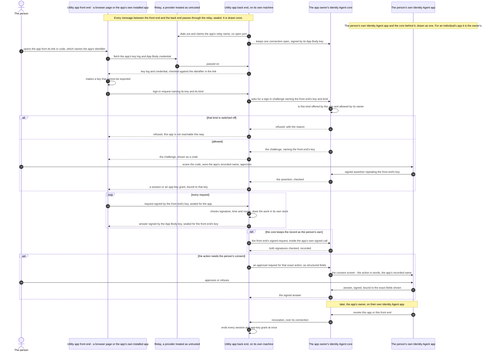

# ADR-072: A Utility App Is Reached Through Its Own Back End, Never Through the Identity Agent

**Status:** Accepted (2026-11-09)
**Date:** 2026-11-09
**Deciders:** Rob Andersen
**Amends:** ADR-066 (its implementation note "A signed-in person speaks to an AI agent from the app's page")
**Builds on:** ADR-006 (no browser reaches the core), ADR-012 Amendment 5 (the rows an app beside an Identity Agent declares), ADR-021 (the Ask), ADR-045 Amendment 1 (an app is an asset with a grant and a body), ADR-048 (the relay)

---

## Context

Two different kinds of software serve one person or organisation, and they must not be confused.

- **The Identity Agent** is the identity. Its core holds the keys and makes every decision about the identity, on a phone or on a machine that can prove what software it runs. It is controlled only from an installed Identity Agent app: the device holding the root identity, or a controller, as ADR-006 defines both. Never from a browser (ADR-006, amended 2026-11-07).
- **A utility app** gives the person a use of their identity. This ADR uses the name for what ADR-012 Amendment 5 calls an *app beside an Identity Agent*: a chat app with AI agents, a task tracker, calling, messages, email, or anything anyone writes. It runs on a machine of its own or a shared one, never inside the Identity Agent. It is an asset of an Identity Agent, its **owner's**, with its own identifier, an App Grant, and an App Body: the machine key it runs under (ADR-045 Amendment 1).

A utility app needs a front end a person can use. ADR-012 Amendment 5 already lets an app declare its front ends (`device_front_ends`: `browser` and/or `installed_app`) and where a browser page is served from (`static_front_end_url`). What no ADR has said is how a front end reaches its app, what it may talk to, and who decides which front ends a person may use.

Without that, the shortcut is for the front end to call the Identity Agent core directly. One path does that today. ADR-066's implementation note "A signed-in person speaks to an AI agent from the app's page" lets a page call the core's talk routes with a browser key. The core answers CORS for that app's origin on those routes. ADR-006's 2026-11-07 amendment lists it as one of three places that do not conform yet, "being reworked so that the app asks from its own server". This ADR is the shape it is reworked to.

## Decision

### 1. A front end talks only to its own app's back end

A utility app's front end, whether a page in a browser or the app's own installed app, sends its requests to that app's back end and to nothing else. **It never calls an Identity Agent core, and no core answers a utility app's browser origin.** The back end talks to its owner's Identity Agent as an enrolled app, signed by its App Body key over its own connection.

**Where the core keeps a record as the person's own** (for example, a message the person sends an AI agent), the back end passes the front end's signed request on inside its own signed call, and the core checks both signatures: the app's, and the key the person's sign-in approved. The request reaches the core only through the back end.

**A utility app's front end is never an Identity Agent app.** The Identity Agent app shows only what governs the identity: keys, credentials, grants, revocation, recovery, the governance record, and the universal approval and consent screens. It also lists the person's utility apps, with each one's settings and a way to open it.

### 2. Every front end follows one protocol

The same steps for every utility app, whoever wrote it, for an individual or an organisation:

1. **The page comes from a fixed address.** A browser front end is loaded from the app's `static_front_end_url` (ADR-012 Amendment 5), never through a relay (ADR-048 §12) and never from a core. An installed front end is the app's own installed app.
2. **The link names the app.** A person opens the app from a link or code carrying the app's identifier. The front end fetches that identifier's key log and the app's App Body credential, checks that the credential has not been revoked, and from then on accepts answers only when they are signed by the machine key that credential names. Whoever carries the traffic cannot substitute another app.
3. **The front end makes a key it cannot export.** A browser makes one per ADR-066. An installed app makes one in the device's secure hardware.
4. **Sign-in is the Ask** (ADR-021). The owner's Identity Agent issues the challenge for the app, naming the front end's key (as ADR-066's `browser_key` does) and its kind, `browser` or `installed_app`. The person approves on their own Identity Agent app, and the signed assertion repeats the key. The back end then binds the person to that key: a **session** for a browser, or an **app-key grant** for an installed app, the installed counterpart of a session, which lasts until it is revoked.
5. **Every request after that is signed by the front end's key** over its method, target, a hash of its body, the app's identifier, the session, a timestamp and a nonce. It is **sealed for the app's back end**, and every answer is signed by the App Body key and sealed for the front end's key. The app's machine opens no port, so the traffic passes through a relay (ADR-048), which carries ciphertext only.

### 3. Which front ends an app may be reached by is a setting per app

An app declares the front ends it offers in `device_front_ends`. Some apps will only ever have one: a phone dialler is an installed app, and a dashboard may be a page. Many have both. **The app's owner may switch off any front end the app offers, and cannot switch on one it does not offer.** The owner's Identity Agent enforces the setting when it issues a sign-in challenge for the app. It refuses one whose front-end kind is not offered or is switched off, and gives the reason. The app's back end is never trusted to enforce this, because an app that has been broken into would ignore it.

For an individual, the owner and the person signing in are the same, and so are their Identity Agents. For an organisation's app they differ: the organisation's Identity Agent holds the app, keeps its connection and enforces the setting, while each person approves on their own Identity Agent.

### 4. No utility app controls an Identity Agent

**A utility app never controls an identity: it is a third-party app anyone can write. Anything that manages an identity, which is anything owner-only, is done only by a designated Identity Agent controller app. A utility app is everything that uses the identity.** The core therefore refuses an app's key on every owner-only route and every controller-only route.

A utility app holds no key that speaks for any identity, through any front end. When it needs something only its owner's Identity Agent can give (a capability call, its data key, a request sent with a stored credential), its back end asks over its own connection, signed by its App Body key. The Identity Agent grants or refuses, and records the answer.

### 5. An action that needs consent is approved on an Identity Agent app

When an app needs the person to approve one specific action, such as sending a payment or adding a contact, its back end sends the request as **structured fields** naming that action, signed by its App Body key. The person sees it on their Identity Agent app's consent screen, in that screen's fixed layout, and their signed answer is bound to the exact fields shown. The app never supplies a layout, markup or code. The name shown for the app comes from its asset record, never from a name the app supplies about itself.

### 6. Revocation is immediate

When the owner revokes an app, or one front end of it, the owner's Identity Agent tells the app's back end over its connection. The back end ends every session and app-key grant at once.

## Consequences

- **One way in for every app.** A developer writing a utility app builds against this protocol and needs nothing from an Identity Agent's routes except the sign-in Ask and the app's own connection.
- **The core's surface does not grow per app.** No core serves an app's page or answers an app's browser origin. The talk-route path ADR-066 described moves behind the app's back end: the core stops answering the app's origin there and admits the person's signed request only inside the app's own call.
- **An Identity Agent is the control point, never the data path.** It approves sign-ins, enforces which front ends an app may use, answers the app's requests and asks for consent. The app's own traffic does not pass through it.
- **ADR-006's other two non-conforming places are not settled here.** The app display at `/apps/{app_id}/` and `/sandbox/llm/v1` belong to the older sandboxed-app kind. This ADR covers only apps beside an Identity Agent, so they stay listed in ADR-006 until they are reworked.
- **Stated weaknesses.** The relay is a provider the person did not choose to trust. It reads nothing, but it sees that somebody reached the app and when, and it can refuse to carry traffic. On phones whose operating system wakes a closed app only through the platform's push service, an app that must ring or notify has to send a sealed wake-up through that service. The wake-up carries nothing readable, but on that platform it is a dependency the person cannot avoid.

## What this does not settle

- **The client library.** A library implementing this protocol for browser pages and installed apps belongs beside the formats it implements. This ADR fixes the protocol, not the library.
- **Wire formats**, with test vectors, for: the front-end kind in a challenge; the owner's setting; the sealing of front-end traffic; the back end's call carrying a front end's signed request; and an app's approval request for one action. Each is set when it is built.

## What is built

**Built:**
- the Ask (ADR-021)
- the browser key in a challenge and an assertion (ADR-066)
- the app manifest's `device_front_ends` and `static_front_end_url` (ADR-012 Amendment 5)
- the relay for an Identity Agent (ADR-048)
- the App Grant and App Body formats (ADR-045 Amendment 1); the App Grant is issued by `ProvisionAppAsset`, which no route calls yet
- an app's back end signing as the app, with its App Body key, to the routes an app may use (Amendment 1)

**Not built:**
- a front end checking the app's key log and App Body credential
- an installed front end's hardware key and its app-key grant
- the front-end kind in a challenge
- the owner's setting and its enforcement
- an app claiming its own relay name
- sealed front-end traffic
- the back end carrying a front end's signed request to the core
- an app's approval request for one action
- revocation pushed to the app

The talk-route path that ADR-066 describes is built, and conforms to this ADR as of Amendment 1.

## Amendment 1 (2026-11-10): how an app's back end signs as the app

*Amended 2026-11-10. This settles what section 4 and section 1 left open for the talk routes, which an earlier change had built with the app's machine as a controller. The amendment is this section and three edits above it, each made by it: the bold sentence that opens section 4, the new last line of the Built list, and the closing line of "What is built", which no longer says the talk-route path does not conform. Nothing else above is changed.*

**The request.** An app's back end signs each request to its owner's Identity Agent with its App Body key (ADR-045 Amendment 1), in the form an AI agent's body signs (ADR-046, `IA-BODY-REQ-V3`, headers `X-IA-Body-*`). The format, what the Identity Agent checks and the order it checks it in are published as a contract with vectors and an independent checker: `identity-agent-core/contracts/app-request/app-request.md`. The key is the one an App Body credential in force names, held by an app of this Identity Agent, and the app holds an App Grant in force that holds the capability the route needs.

**Which routes.** An app may use only the routes the core lists for it, and an add-on may list its own (`Addon.AppRoutes`). The core lists the one route that carries a person's words, `POST /api/mcp/agents/{id}/conversations`, which needs `agent.message.send`. Where the app's App Grant limits that capability (`resource_constraints`), the limit on `to` is held to the AI agent in the path, by the identifier its entries are addressed to (its `pairwise_aid`, as a person's statement names it) and never by the asset id: an app limited to one AI agent cannot post to another's route. A grant that limits an argument the route does not give is refused on that route, because a limit that cannot be checked is not read as none (`contracts/app-request/app-request.md`, refusal 8). An add-on lists the argument each of its routes gives, so its own limits are held the same way, and an app is held to its request rate on every route it may use. Reads of a conversation are not listed until a read is scoped to a person. Every other route refuses an app's key: every route a controller may use, and every owner-only one. No score and no signer is involved, because an app is neither.

**A person's words.** The person-statement rule of ADR-067 is unchanged: on the route that carries a person's words, a request is accepted only with the person's own signed statement beside the app's signature (`X-IA-Speaking-For`, `X-IA-Person-Statement`, `X-IA-Person-Salt`). The app's signature covers the request, not those three headers; the statement names the words, conversation, recipient and message it is for, is signed by the person's own key and is spent once.

**What the record keeps.** The person's statement is kept as the proof of what was asked, never the app's signed request, which holds their words (ADR-068), with the App Body credential that names the app's key (`ControllerProof.AppBody`), so a conversation bundle shows which app's machine carried the person's statement by a credential anybody can check. A controller's request is kept as before.

**Controller Grant 1.2.0.** An app is not a controller, so its `app_asset` is not written and not honoured. Nothing binds a machine to an app. The schema stays published, byte for byte, so a credential issued under it still reads; a later version may drop the field. The path arrived in #436, three merges before this change, and is not known to have reached any outside adopter, so none is taken to hold such a credential or such a record; if one does, this is the call that is wrong for them, and it is reversed by reading their entries in `checkPersonSpoke` as before. Three consequences, each decided:

- *The credentials are withdrawn.* A machine recorded as bound to an app stops standing (`ControllerGrant.Live`), and at start-up the Identity Agent removes each one and withdraws its Controller Grant in the registry, once (`withdrawTheGrantsOfRetiredAppBackEnds`), so no credential still shows it in force. Where the key is on another device the withdrawal is queued for it, as for any machine its owner removes.
- *The records fault.* A conversation entry made through such a machine, a controller's request with a person's statement under a Controller Grant that names `app_asset`, now faults in the conversation bundle (`checkPersonSpoke`), as a controller that is no longer one. It is not read as a plain controller's entry and not excused as having been valid when made: no outside adopter is known to hold one, and keeping a second reading of an app's entry alive would keep the controller path this amendment removes. Entries an app signed as the app are read by `checkAppSpoke`.
- *The bundle's name for the app changes meaning.* The conversation bundle's `Message.App` (JSON `app_asset`) was the asset id a Controller Grant named. It is now `Message.AppAID` (JSON `app_aid`): the identifier of the app that holds the App Body credential whose key signed the request. It was renamed rather than kept under the old name, because the old name would have carried a different thing.

**Not settled here.** The sign-in challenge's front-end kind, the owner's per-front-end setting, sealed front-end traffic, an app's approval request for one action, and revocation pushed to the app remain as listed above. An app's key is refused on the routes that serve them until each is built and listed.
