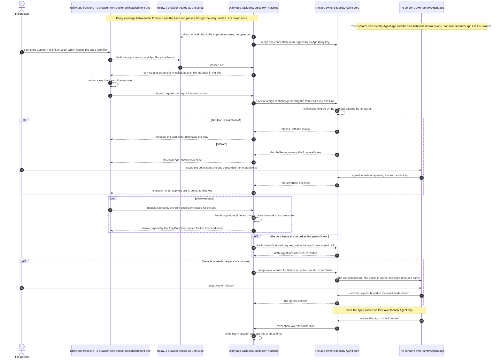

# ADR-072: A Utility App Is Reached Through Its Own Back End, Never Through the Identity Agent

**Status:** Accepted (2026-11-09)
**Date:** 2026-11-09
**Deciders:** Rob Andersen
**Amends:** ADR-066 (its implementation note "A signed-in person speaks to an AI agent from the app's page")
**Builds on:** ADR-006 (no browser reaches the core), ADR-012 Amendment 5 (the rows an app beside an Identity Agent declares), ADR-021 (the Ask), ADR-045 Amendment 1 (an app is an asset with a grant and a body), ADR-048 (the relay)

---

## Context

Two different kinds of software serve one person or organisation, and they must not be confused.

- **The Identity Agent** is the identity. Its core holds the keys and makes every decision about the identity, on a phone or on a machine that can prove what software it runs. It is controlled only from an installed Identity Agent app: the device holding the root identity, or a controller, as ADR-006 defines both. Never from a browser (ADR-006, amended 2026-11-07).
- **A utility app** gives the person a use of their identity. This ADR uses the name for what ADR-012 Amendment 5 calls an *app beside an Identity Agent*: a chat app with AI agents, a task tracker, calling, messages, email, or anything anyone writes. It runs on a machine of its own or a shared one, never inside the Identity Agent. It is an asset of an Identity Agent, its **owner's**, with its own identifier, an App Grant, and an App Body: the machine key it runs under (ADR-045 Amendment 1).

### The parts of a utility app, and the configurations it runs in

A utility app has two kinds of part, and this ADR uses these names for them throughout.

- **The back end** holds the app's data and does its work, on the machine the app runs on. It is the part that is enrolled as the app and holds the App Body key.
- **A front end** is the part a person uses. It comes in two kinds:
  - **A browser front end** is a page loaded in a browser.
  - **An installed front end** is the app's own installed app on the person's device. It may also work in the background, for example to ring or notify, when it is not open on screen.

Where the parts run gives four configurations. The protocol in this ADR is the same in all four; only who runs each part differs.

1. **A browser front end hosted by another party.** A page served from a fixed address by someone other than the back end's operator, talking to a back end run by someone else.
2. **A browser front end and back end run by one operator.** The same operator serves the page and runs the back end.
3. **An installed front end with the back end elsewhere.** The installed app is on the person's device and the back end runs on another machine.
4. **An installed front end and back end on one device.** Both run on the person's own device.

A utility app needs a front end a person can use. ADR-012 Amendment 5 already lets an app declare its front ends (`device_front_ends`: `browser` and/or `installed_app`) and where a browser page is served from (`static_front_end_url`). What no ADR has said is how a front end reaches its app, what it may talk to, and who decides which front ends a person may use.

Without that, the shortcut is for the front end to call the Identity Agent core directly. One path does that today. ADR-066's implementation note "A signed-in person speaks to an AI agent from the app's page" lets a page call the core's talk routes with a browser key. The core answers CORS for that app's origin on those routes. ADR-006's 2026-11-07 amendment lists it as one of three places that do not conform yet, "being reworked so that the app asks from its own server". This ADR is the shape it is reworked to.

## Decision

### 1. A front end talks only to its own app's back end

A utility app's front end, whether a browser front end or an installed front end, sends its requests to that app's back end and to nothing else. **It never calls an Identity Agent core, and no core answers a utility app's browser origin.** The back end talks to its owner's Identity Agent as an enrolled app, signed by its App Body key over its own connection.

**Where the core keeps a record as the person's own** (for example, a message the person sends an AI agent), the back end passes the front end's signed request on inside its own signed call, and the core checks both signatures: the app's, and the key the person's sign-in approved. The request reaches the core only through the back end.

**A utility app's front end is never an Identity Agent app.** The Identity Agent app shows only what governs the identity: keys, credentials, grants, revocation, recovery, the governance record, and the universal approval and consent screens. It also lists the person's utility apps, with each one's settings and a way to open it.

### 2. Every front end follows one protocol

The same steps for every utility app, whoever wrote it, for an individual or an organisation:

1. **The page comes from a fixed address.** A browser front end is loaded from the app's `static_front_end_url` (ADR-012 Amendment 5), never through a relay (ADR-048 §12) and never from a core. An installed front end is the app's own installed app, which may also work in the background.
2. **The page names the app; the link only opens it.** A browser front end is pinned to one app by its own published configuration, served beside it from the same origin: the app's identifier, the relay identifier, the back end's address and what the relay identifier's key log is checked against (Amendment 6). A link or code a person opens carries the app's identifier too, and a page refuses one that names any other app, relay identifier or back end. A page with no pin signs nobody in. An installed front end is its own app's, so it is pinned by what it is. The front end fetches that identifier's key log and the app's App Body credential, checks that the credential has not been revoked, and from then on accepts answers only when they are signed by the machine key that credential names. Whoever carries the traffic cannot substitute another app.
3. **The front end makes a key it cannot export.** A browser makes one per ADR-066. An installed app makes one in the device's secure hardware.
4. **Sign-in is the Ask** (ADR-021). The owner's Identity Agent issues the challenge for the app, naming the front end's key (as ADR-066's `browser_key` does) and its kind: `browser` for a browser front end, `installed_app` for an installed front end. The person approves on their own Identity Agent app, and the signed assertion repeats the key. The back end then binds the person to that key: a **session** for a browser, or an **app-key grant** for an installed app, the installed counterpart of a session, which lasts until it is revoked.
5. **Every request after that is signed by the front end's key** over its method, target, a hash of its body, the app's identifier, the session, a timestamp and a nonce. It is **sealed for the app's back end**, and every answer is signed by the App Body key and sealed for the front end's key. The app's machine opens no port, so the traffic passes through a relay (ADR-048), which carries ciphertext only.

### 3. Which front ends an app may be reached by is a setting per app

An app declares the front ends it offers in `device_front_ends`. Some apps will only ever have one: a phone dialler is an installed app, and a dashboard may be a page. Many have both. **The app's owner may switch off any front end the app offers, and cannot switch on one it does not offer.** The owner's Identity Agent enforces the setting when it issues a sign-in challenge for the app. It refuses one whose front-end kind is not offered or is switched off, and gives the reason. The app's back end is never trusted to enforce this, because an app that has been broken into would ignore it.

For an individual, the owner and the person signing in are the same, and so are their Identity Agents. For an organisation's app they differ: the organisation's Identity Agent holds the app, keeps its connection and enforces the setting, while each person approves on their own Identity Agent.

### 4. No utility app controls an Identity Agent

**A utility app never controls an identity: it is a third-party app anyone can write. Anything that manages an identity, which is anything owner-only, is done only by a designated Identity Agent controller app. A utility app is everything that uses the identity.** The core therefore refuses an app's key on every owner-only route and every controller-only route.

A utility app holds no key that speaks for any identity, through any front end. When it needs something only its owner's Identity Agent can give (a capability call, its data key, a request sent with a stored credential), its back end asks over its own connection, signed by its App Body key. The Identity Agent grants or refuses, and records the answer.

### 5. An action that needs consent is approved on an Identity Agent app

When an app needs the person to approve one specific action, such as sending a payment or adding a contact, its back end sends the request as **structured fields** naming that action, signed by its App Body key. The person sees it on their Identity Agent app's consent screen, in that screen's fixed layout, and their signed answer is bound to the exact fields shown. The app never supplies a layout, markup or code. The name shown for the app comes from its asset record, never from a name the app supplies about itself.

### 6. Revocation is immediate

When the owner revokes an app, or one front end of it, the owner's Identity Agent tells the app's back end over its connection. The back end ends every session and app-key grant at once.

## Consequences

- **One way in for every app.** A developer writing a utility app builds against this protocol and needs nothing from an Identity Agent's routes except the sign-in Ask and the app's own connection.
- **The core's surface does not grow per app.** No core serves an app's page or answers an app's browser origin. The talk-route path ADR-066 described moves behind the app's back end: the core stops answering the app's origin there and admits the person's signed request only inside the app's own call.
- **An Identity Agent is the control point, never the data path.** It approves sign-ins, enforces which front ends an app may use, answers the app's requests and asks for consent. The app's own traffic does not pass through it.
- **ADR-006's other two non-conforming places are not settled here.** The app display at `/apps/{app_id}/` and `/sandbox/llm/v1` belong to the older sandboxed-app kind. This ADR covers only apps beside an Identity Agent, so they stay listed in ADR-006 until they are reworked.
- **Stated weaknesses.** The relay is a provider the person did not choose to trust. It reads nothing, but it sees that somebody reached the app and when, and it can refuse to carry traffic. On phones whose operating system wakes a closed app only through the platform's push service, an app that must ring or notify has to send a sealed wake-up through that service. The wake-up carries nothing readable, but on that platform it is a dependency the person cannot avoid.

## What this does not settle

- **The client library.** A library implementing this protocol for browser pages and installed apps belongs beside the formats it implements. This ADR fixes the protocol, not the library.
- **Wire formats**, with test vectors, for: the owner's setting (its routes are built, Amendment 2); the sealing of front-end traffic; the back end's call carrying a front end's signed request; and an app's approval request for one action. Each is set when it is built.

## What is built

**Built:**
- the Ask (ADR-021)
- the browser key in a challenge and an assertion (ADR-066)
- the app manifest's `device_front_ends` and `static_front_end_url` (ADR-012 Amendment 5)
- the relay for an Identity Agent (ADR-048)
- the App Grant and App Body formats (ADR-045 Amendment 1); the App Grant is issued by `ProvisionAppAsset`, which no route calls yet
- an app's back end signing as the app, with its App Body key, to the routes an app may use (Amendment 1)
- the front-end kind in a challenge and an assertion, with test vectors (Amendment 2)
- the owner's setting of which front ends an app offers may be used through, and its enforcement when a sign-in starts and again when it is approved (Amendment 2)
- an installed front end's hardware key, proved by a hardware attestation the core verifies, and its app-key grant, which lasts until it is ended and which the person and the owner can end (Amendment 3)
- sealed front-end traffic: the format, test vectors, the page's side in TypeScript and in Dart (`packages/login-dart`, which every installed front end uses), and the Go side (Amendment 4)
- a relay identifier's witnesses, the owner's declaration that makes a witness hold its log, and the page's and Dart's reading of the log from them, with test vectors (Amendment 5)
- the relay identifier in a utility app's sign-in challenge, the owner's record of it, and the page's and Dart's check of it against the link, with test vectors (Amendment 7)

**Not built:**
- a front end checking the app's key log and App Body credential
- an installed front end's hardware key proved on **Windows** (the TPM verifier is written and refuses everything until the manufacturers' roots and the credential round trip exist, Amendment 3)
- an app claiming its own relay name
- the back end carrying a front end's signed request to the core
- an app's approval request for one action
- revocation pushed to the app

The talk-route path that ADR-066 describes is built, and conforms to this ADR as of Amendment 1.

## Amendment 1 (2026-11-10): how an app's back end signs as the app

*Amended 2026-11-10. This settles what section 4 and section 1 left open for the talk routes, which an earlier change had built with the app's machine as a controller. The amendment is this section and three edits above it, each made by it: the bold sentence that opens section 4, the new last line of the Built list, and the closing line of "What is built", which no longer says the talk-route path does not conform. Nothing else above is changed.*

**The request.** An app's back end signs each request to its owner's Identity Agent with its App Body key (ADR-045 Amendment 1), in the form an AI agent's body signs (ADR-046, `IA-BODY-REQ-V3`, headers `X-IA-Body-*`). The format, what the Identity Agent checks and the order it checks it in are published as a contract with vectors and an independent checker: `identity-agent-core/contracts/app-request/app-request.md`. The key is the one an App Body credential in force names, held by an app of this Identity Agent, and the app holds an App Grant in force that holds the capability the route needs.

**Which routes.** An app may use only the routes the core lists for it, and an add-on may list its own (`Addon.AppRoutes`). The core lists the one route that carries a person's words, `POST /api/mcp/agents/{id}/conversations`, which needs `agent.message.send`. Where the app's App Grant limits that capability (`resource_constraints`), the limit on `to` is held to the AI agent in the path, by the identifier its entries are addressed to (its `pairwise_aid`, as a person's statement names it) and never by the asset id: an app limited to one AI agent cannot post to another's route. A grant that limits an argument the route does not give is refused on that route, because a limit that cannot be checked is not read as none (`contracts/app-request/app-request.md`, refusal 8). An add-on lists the argument each of its routes gives, so its own limits are held the same way, and an app is held to its request rate on every route it may use. Reads of a conversation are not listed until a read is scoped to a person. Every other route refuses an app's key: every route a controller may use, and every owner-only one. No score and no signer is involved, because an app is neither.

**A person's words.** The person-statement rule of ADR-067 is unchanged: on the route that carries a person's words, a request is accepted only with the person's own signed statement beside the app's signature (`X-IA-Speaking-For`, `X-IA-Person-Statement`, `X-IA-Person-Salt`). The app's signature covers the request, not those three headers; the statement names the words, conversation, recipient and message it is for, is signed by the person's own key and is spent once.

**What the record keeps.** The person's statement is kept as the proof of what was asked, never the app's signed request, which holds their words (ADR-068), with the App Body credential that names the app's key (`ControllerProof.AppBody`), so a conversation bundle shows which app's machine carried the person's statement by a credential anybody can check. A controller's request is kept as before.

**Controller Grant 1.2.0.** An app is not a controller, so its `app_asset` is not written and not honoured. Nothing binds a machine to an app. The schema stays published, byte for byte, so a credential issued under it still reads; a later version may drop the field. The path arrived in #436, three merges before this change, and is not known to have reached any outside adopter, so none is taken to hold such a credential or such a record; if one does, this is the call that is wrong for them, and it is reversed by reading their entries in `checkPersonSpoke` as before. Three consequences, each decided:

- *The credentials are withdrawn.* A machine recorded as bound to an app stops standing (`ControllerGrant.Live`), and at start-up the Identity Agent removes each one and withdraws its Controller Grant in the registry, once (`withdrawTheGrantsOfRetiredAppBackEnds`), so no credential still shows it in force. Where the key is on another device the withdrawal is queued for it, as for any machine its owner removes.
- *The records fault.* A conversation entry made through such a machine, a controller's request with a person's statement under a Controller Grant that names `app_asset`, now faults in the conversation bundle (`checkPersonSpoke`), as a controller that is no longer one. It is not read as a plain controller's entry and not excused as having been valid when made: no outside adopter is known to hold one, and keeping a second reading of an app's entry alive would keep the controller path this amendment removes. Entries an app signed as the app are read by `checkAppSpoke`.
- *The bundle's name for the app changes meaning.* The conversation bundle's `Message.App` (JSON `app_asset`) was the asset id a Controller Grant named. It is now `Message.AppAID` (JSON `app_aid`): the identifier of the app that holds the App Body credential whose key signed the request. It was renamed rather than kept under the old name, because the old name would have carried a different thing.

**Not settled here.** The sign-in challenge's front-end kind, the owner's per-front-end setting, sealed front-end traffic, an app's approval request for one action, and revocation pushed to the app remain as listed above. An app's key is refused on the routes that serve them until each is built and listed.

## Amendment 2 (2026-11-11): the front-end kind is named in the signed challenge, and what the owner's setting does and does not do yet

*Amended 2026-11-11. This builds the front-end kind in a challenge and the owner's per-front-end setting that section 2 step 4 and section 3 left to be built. Edits above, each made by this amendment: two lines moved from "Not built" to "Built", and the wire-formats line of "What this does not settle". Nothing else above is changed.*

**The kind is in the signed challenge and repeated in the assertion.** A challenge for a utility app carries `front_end` (`browser` or `installed_app`) in its signed body, written between `browser_key` and `callback_url` and left out when the challenge names none, so every other challenge keeps its form. The person's assertion repeats it as `front_end`, the signature covers it, and a verifier refuses an assertion whose kind is not the one the challenge named, or that names one where the challenge named none, with the reason `front end mismatch`. It is checked after the browser key and before the signature. The person's Identity Agent carries the kind in its consent preview; showing it on the consent screen is not built yet, and matters once installed apps can sign in, since an installed_app sign-in is refused until then. Test vectors: `packages/login-verify/test-vectors/verify-decisions.json` (the front-end cases) and `core-canonical-and-spellings.json` (one challenge and one assertion that name a kind), held in Go and TypeScript alike. A challenge with a kind that is not one of the two is refused by the person's Identity Agent before consent.

**A kind is believed only as far as the request backs it.** The kind is what the caller says, and a web page can say anything. So:
- `installed_app` is accepted only when the request carries an installed app's own key. *(Amendment 3 builds that key. What follows is true of every route except the one add-on call Amendment 3 describes, and there it is true unless the core has verified a hardware attestation.)* That key (the installed front end's hardware key and its app-key grant) was not built when this was written, so until it is, **every `installed_app` sign-in is refused on every route.** Without it an installed-app sign-in is a bearer QR sign-in that nothing tells from a browser's, and a page could call itself the installed app to get round a switched-off browser.
- A request from a web page (it carries a browser `Origin` header), or for a browser's key, is a browser's, and is refused if it names any other kind.

**Older apps.** An app made before it could declare its front ends has no list, and a missing list means *not declared*, never *offers none*: such an app signs people in as it always did. Whether the owner has declared is stored apart from the list, so a declared empty list still refuses every sign-in. The list is set when the app is made or its enrolment token is issued, by the owner and never by the enrolling machine, or when it is provisioned as a delegated app (`ProvisionAppAsset` takes it). For an app that has none, the owner may declare it once, from its manifest's `device_front_ends` (`PUT /api/assets/{id}/front-ends/offered`); a second declaration is refused, because what an app offers is not for the owner's switches to grow. This route and `PUT /api/assets/{id}/front-ends` are the owner's alone, and reading is open to the owner's paired controllers (ADR-050).

**Switching off applies to new sign-ins only, until revocation push exists.** The owner's Identity Agent checks the setting when it issues a challenge and again when the approval completes, so a challenge issued just before the switch cannot be approved after it. A session or app-key grant already open is not ended: section 6's revocation push to the app's back end is not built, so people already signed in stay signed in until they sign out.

**Accepted: the refusal reasons on a public route say what the owner set.** A sign-in is asked for on a public route, and its refusal says that the app does not offer a front end or that its owner has switched it off, so anyone who can reach the route can learn which front ends an app offers and which are off. The front end needs the words to tell the person, and the setting is not a secret from people the app is for.

**Not built, still:** the installed front end's hardware key and app-key grant (the proof `installed_app` waits for), and revocation pushed to the app.

**Accepted for now: an installed app signs in as `browser`.** Until an installed app has a key of its own (above), the installed Flutter apps sign in with a browser key and name the `browser` kind, because `installed_app` is refused on every route. So **switching off "browser" on an app also stops its installed apps, and switching off "installed app" stops nothing yet.** The owner's switch says so in plain words where it is shown. When the installed app's own key is built, installed apps move to `installed_app` and the two switches mean what they say.

## Amendment 3 (2026-11-13): an installed app's key is proved in hardware, and its grant can be ended

*Amended 2026-11-13. This builds what Amendment 2 listed as not built: the installed front end's hardware key and its app-key grant. Edits above, each made by this amendment: two lines of "What is built", and a pointer inside Amendment 2's bullet on `installed_app`. Nothing else above is changed.*

**The kind is proved, never claimed.** Amendment 2 refused `installed_app` everywhere because naming the kind is no proof. The core now accepts it on one path only: the add-on call that starts a sign-in for an app's front end (`addon.Host.StartFrontEndKeySignIn`), when all of these hold, each checked by the core and none read from the caller:

- the caller is the app's back end, shown either by the core's own check of an App Body signature or, on a route an add-on authenticates itself, by the app the add-on found asking (and where both exist they must agree); the request did not come from a web page (a browser `Origin` or Fetch-Metadata header refuses it, however it reached the add-on's route); and the asset is that app's own;
- the request carries a **hardware attestation of the key**, which the core verifies itself and which names the same key the sign-in names:
  - **Android:** Android Key Attestation to a pinned Google root, for a P-256 key the hardware generated and limits to signing, on a phone whose bootloader is locked and whose boot verified (an unlocked or unverified phone attests honestly and is refused, because anyone with root on it can ask the hardware to sign), whose attested package and signing certificates are the ones the owner named. The attestation also states the verified boot key, which the core reads and does not yet pin;
  - **iOS and macOS:** Apple App Attest to Apple's pinned root, for the owner's `<team id>.<bundle id>`;
  - **Windows:** a TPM key certify to pinned manufacturer roots. A TPM proves the key is in the computer's TPM and not which program holds it, so it is accepted only where the owner has said they accept that (`tpm_keys`);
- the attestation is **fresh**. The app's back end first asks the core for one attestation (`addon.Host.BeginInstalledAppKey`): the core answers a random challenge, which the hardware attests the key with, and the ask is for that asset, used once and expires in five minutes, and capped per asset. The ask is spent when the proof is read, whether or not it holds, so a leaked attestation cannot be shown again. And **the key signs each sign-in**: a statement naming the asset, the ask's challenge and the key (`InstalledAppSignInStatement`), so only whoever holds the key can start one. For an Apple App Attest key, which signs only assertions, that is an App Attest assertion whose client data hash is the statement's SHA-256.

The public routes still pass no proof, so a page cannot get `installed_app` from them.

**The owner names the installed program.** An attestation proves a key is in hardware, and only the program's identity says it is held by this app's program and not another on the same phone. The owner states it when the app is made or enrolled, beside `device_front_ends` (ADR-012 Amendment 5, row `front_and_back_end`, `installed_app_identity`): `android_package` with `android_signers` (SHA-256 digests of the signing certificates), `apple_app_id`, and `tpm_keys`. It is never supplied by the app's back end at sign-in. An app whose owner named none accepts no installed-app key.

**The person sees what they approve.** The consent data the person's Identity Agent gives its screens carries the front-end kind (as before) and `lasts_until_ended`, true for `installed_app`. The screens show the kind and "until you end it" before approving.

**An Apple key speaks by assertion.** An App Attest key cannot sign a plain statement, so a person's statement signed by such a key carries an App Attest assertion over the statement's SHA-256, which the core checks (`secureenclave.VerifyAppleAssertion`, through `trail.AssertionRoster`) for the program the owner names now. A plain signature is never read as an Apple key's. The assertion counter is returned and not judged: a statement is one-use and expires in minutes, which stops a replay. The test vector is made by Apple's published steps with a software key; no device has produced one.

**A live grant is not replaced.** A sign-in naming a key that already holds a live grant for another person is refused (the grant does not lapse, so it would otherwise be lost to whoever started a sign-in naming it); the same person signing in again refreshes it.

**What a grant is, and how it ends.** The record keeps the key, the person, and how the core proved the key (platform and hardware level). It has no lapse time; only an installed app's record may have none (a browser's record without one speaks for no one). Each use asks the owner's setting again, so a switched-off front end stops speaking at once. A grant ends when: the app's back end signs the person out; the person ends it, with their Identity Agent's signed answer to a one-use nonce that expires in five minutes (`POST /api/login/app-key/end/begin`, `POST /api/login/app-key/end`; the begin route is public, so nonces are capped per caller and per asset, and one caller filling its own cap does not stop another); the owner ends it (`DELETE /api/assets/{id}/app-key-grants/{key}`, read with `GET` on the same path); the owner switches the front end off; or the person is removed from the asset. A deleted asset speaks for no one. A grant ended is gone: switching a front end back on or adding the person again does not wake it.

**The person's own record, and two routes on their Identity Agent.** Approving an installed app's sign-in keeps a record in the person's own Identity Agent (`installed_app_sign_ins.json`, mode 0600, holding no secret): the key, the app's identifier, the address its host takes the end at (the sign-in's callback address without `/callback`), and when it was approved. It is kept before the sign-in is posted, so a grant the host accepts always has a record to end it by. The record is dropped only when the host definitely refuses the sign-in (a 4xx); a timeout or a 5xx may have come after the host accepted, so the record stays, and the host's 410 (below) clears it if no grant exists. Two routes serve the person's screens, both on their Identity Agent and neither open to an AI agent or an app: `GET /api/login/installed-apps` answers `{"installed_app_sign_ins": [...]}`, newest first, and `POST /api/login/installed-apps/end` takes `{"site_aid", "key"}` and answers `{"ok":true,"ended":true,"already_ended":bool}`, with `already_ended` true and a plain `message` when the host said the grant was no longer live. It answers `404` for a key the person has no record of, `409` when the host did not end it, or the record has no end address or relationship, and `502` when the host cannot be reached or answers something unreadable; in every one the record stays.

**What every host must answer: 410 "no longer live".** A host that holds an installed app's grant answers `410 Gone`, body `{"error":"no longer live"}`, from both `POST /api/login/app-key/end/begin` and `POST /api/login/app-key/end` when the grant is not live (the owner ended it, it was ended already, or it never existed). The person's Identity Agent matches the status, not the text, and on a 410 forgets its record and tells the person it had already ended. A host that answers anything else for a grant that is gone leaves the person's list showing a sign-in that cannot be ended. This is a wire behaviour of the host, not of the person's Identity Agent.

**What the person's Identity Agent signs when it ends one.** The host's `/begin` reply names the audience, nonce, site and key, and the host is not trusted with the first, the site or the key: the Identity Agent signs only when the audience is exactly `end-app-key` (`login.EndAppKeyAudience`), the site is the one in its own record, the key is the record's and the kind is `installed_app`; otherwise it signs nothing and keeps the record. It signs under the relationship the sign-in was made under and never makes one for an end, so a host cannot get a sign-in valid at another audience or site. Only the nonce comes from the host. Test vectors for the refusals are in `login/installed_app_signins_test.go`.

**Not settled here.** Revocation pushed to the app's back end (section 6) is still not built: the core refuses at each use and ends the record, but does not tell the back end. On Windows nothing can yet be proved: the TPM verifier needs the manufacturers' roots and the core's side of the credential exchange (`TPM2_MakeCredential`, with a secret key the core holds for each attestation and never gives the app: the verifier refuses any credential keyed by the challenge or by public facts, so pinning roots alone does not open it), and until they exist a Windows installed app signs in as `browser` (Amendment 2's accepted case). The Apple and TPM verifiers have never seen a real device's output; the Apple root was downloaded over TLS on 2026-11-13.

**Accepted for now: an installed app on an unproved platform signs in as `browser`.** Where no proof exists yet the installed Flutter apps keep signing in with a browser key and the `browser` kind, so switching off "browser" still stops them there.

## Amendment 4 (2026-11-12): how front-end traffic is sealed, and what the relay still sees

Section 2 step 5 says traffic between a front end and the app's back end is sealed. This sets the format. The test vectors are `packages/login-web/test-vectors/seal.json`; the TypeScript is `packages/login-web/src/seal.ts`, the Go is `packages/login-go/seal.go` and the Dart is `packages/login-dart/lib/seal.dart`, and all three reproduce every request and answer vector byte for byte. The refusals of a sealing key statement (`statement_refusals`) are run by the TypeScript and the Dart here, and by the Go that a host uses to check a statement before it puts it in a link, which is not in this repository.

**The outer call.** Every call is one `POST` to one fixed path, `/sealed`, whose body is `{"v":1,"epk":…,"ct":…}`, and every answer is one `200` whose body is `{"v":1,"n":…,"ct":…}`. Method, route, query, headers, session, proof, status and body are all inside `ct`, so a relay carrying it cannot tell a sign-in from a chat message.

**The seal.** The front end makes a fresh P-256 key for each call (`epk`) and agrees a secret with the back end's sealing key by ECDH. HKDF-SHA256, salted by `epk` then the sealing key, gives the request its AES-256-GCM key and nonce. The answer's are salted by `epk`, the sealing key and `n`, 32 random bytes the back end makes for each answer and carries in it (the page accepts 16 to 32). The answer therefore never depends on `epk` being new: a call answered twice, by a replay that got through or by a restart that forgot, is answered under two different keys. The version, the relay identifier, the direction and `epk` (and, for an answer, `n`) are the associated data, so a call cannot be taken for an answer or for another app's, and a later version cannot relabel these ciphertexts. Every base64url value is read in its one canonical spelling and every field name case-sensitively, in Go, TypeScript and Dart alike: Go's own decoder accepts four spellings of one `epk` (87 characters carry 2 unused bits) and ignores line breaks, which let a relay replay a call past a replay memory keyed on the text. The plaintext is its length (4 bytes), the content, then zeros to a size of 1024 bytes doubling, so size shows only which bucket a message is in. A message may carry 16 MiB at most.

**The sealing key.** The back end's sealing key is derived from the relay identifier's seed, so it is kept nowhere of its own and is the same on every machine the app runs on. The sign-in link carries it as `seal`. The statement is the identifier's whole signed key log, the key, `sn` (the sequence number of the log's last event) and the signature of the key that log names now over the identifier, `sn` and the key. The page reads the log as it reads an answer's, requires `sn` to be the log's last event, and holds it to the longest log it already knows for the identifier, so a key the identifier has rotated away from vouches for nothing and a statement made earlier is not taken for a later one. The link also carries `min`, `<sequence number>.<SAID>` of the latest event of the relay identifier's key log. The owner's Identity Agent holds that log and is the only party that moves it on, so `min` is its last event, and a statement a machine reports must be made at that event: a machine restored from before a rotation, or one removed that still holds its seed, reports a shorter log and is refused, as is a report that leaves out a statement already on record. Where the Identity Agent holds no log (an app whose machine made its own identifier), `min` is the longest log the machine has reported, and a report that does not carry on from it is refused. The page requires the log it is shown to hold that event at that number, so a browser that has never seen the app, or an installed app that has lost its memory, is not handed a true but earlier log (a removed first machine's, whose key the identifier has since left). The page's own memory of the longest log still applies on top; a memory that cannot be read is replaced by the minimum, and refused where there is none. The link also carries `iat`, whole seconds since 1970 when the Identity Agent made it, and the page refuses a link made more than 7 days ago, or dated more than a day ahead of its own clock. `iat` is not signed: it bounds the age of a link people genuinely hold, not a link an attacker rewrites, so it is a courtesy to the person and not a defence against anyone who can edit a link. What this still does not close: `min` is as of the day the link was made, so a browser that has never seen a newer log accepts, for up to those 7 days, a link whose log stops at its `min` and whose statement is signed by a key the identifier has since rotated away from, until it is shown the newer log (a link made after a rotation, or any answer). The owner's Identity Agent moves the identifier on one key whenever a machine is removed or the keys are handed to another machine, and in any case once the key has been in use for 30 days, so a removed machine's seed, or one taken from a machine nobody removed, stops mattering to a browser once it has been shown a log from after the rotation, and no link a person can still use is older than the 7 days a link lives. A running machine asks for its keys every 15 minutes and starts again onto a new one. The permanent answer to a browser that has never been shown a newer log is for a page to resolve the relay identifier's key log from the identifier's witnesses instead of taking it from the link: Amendment 5. A link without `seal`, `min` or `iat` is refused. The sealing key is made from the current key's seed, so a rotation changes it; a front end that holds the earlier one is not stranded ("A rotation does not strand a front end", below). **Links made before this carry none, so they stop working and must be made again.**

**A removed machine that was not destroyed keeps the sealing key.** It is a static key with no forward secrecy: whoever holds it, or later gets the seed, can read every call and answer recorded for this app, past and future, until the relay identifier's key is rotated. Removing a machine that is lost or compromised must therefore be a compromised removal (`Replace`), which rotates the key and so the sealing key; a removal of a machine that was properly destroyed need not. The sealing key lives as long as the relay identifier's key does: the owner's Identity Agent moves that key on whenever a machine is removed as compromised or the keys are handed to another machine, and in any case after 30 days (above), and the sealing key moves with it. What a page or an installed front end does when it meets a move is under "A rotation does not strand a front end" below.

**The signatures travel inside.** The browser's proof (the headers of step 5, unchanged) is part of the sealed call, and the app's signed answer (ADR-072 Amendment 1's `APP-ANSWER-V1`, with the relay identifier's whole key log in place of its inception) is part of the sealed answer. Both are checked after opening, exactly as before. A back end refuses a sealed call whose `epk` (by its decoded bytes, not its spelling) it has seen within the request window, and one dated before it began, so a restart does not reopen the calls it forgot. A call is remembered only once it has opened and is dated well, so what a relay, which cannot seal to the app, posts fills nothing. Whoever holds a sign-in link can seal, though, so a call that names no live session (whatever it puts in its `Authorization` header) is remembered in a small memory of its own, and a call that names one is remembered under that session, which holds only so many: filling either leaves the calls of other signed-in people their room. A back end lets calls that name no live session, sign-in starts among them, through at no more than 20 a second (a burst of 200) and answers the rest `429`, which a page reads as "try again"; 20 a second over the 2-minute window stays under the memory's 5,000, so somebody holding a link and making calls as fast as they are let through cannot fill it. They can still use up that allowance, and while they do a new sign-in is told to try again; signed-in people are not counted in it and are not affected. A call a relay repeats is refused as a repeat before the allowance is looked at, so sending one captured sign-in start again and again spends none of it (a repeat is `400`, never `429`). A sign-in that is waiting for a person's phone has an allowance of its own for asking how it went (one a second, a burst of ten, for each sign-in the back end started and has not finished), so whoever uses up the shared allowance cannot stop it from being answered; the sign-in's id is secret to the page that started it, and at most 1,000 can be waiting, which keeps what they remember inside the memory's bound. The limit is for the back end as a whole because the relay does not tell a back end who sent a call. The memory is each back end process's own, so two back ends serving one relay identifier can each answer a call a relay sends to both, within the window (a call that is not safe to repeat needs a defence of its own, as before). A call that opens but is dated outside the window, as by a device whose clock is wrong, is answered with a signed, sealed `409` whose body is `{"error":"clock","server_time":…}`, and the front end dates the call again by that time, once; a second such answer is said to be the device's clock. The answer is the same on every back end: status `409` and exactly `{"error":"clock","server_time":"<UTC, to the second>"}`; login-go's `ClockAnswer` makes it, and the `clock_answer` case in `packages/login-web/test-vectors/seal.json` holds the TypeScript, Go and Dart ports to it.

**A rotation does not strand a front end.** The relay identifier's key moves on at least every 30 days and on every machine change, and the sealing key moves with it, so a page that was opened, or an installed front end that was set up, before the move seals to a key the back end no longer holds. A back end that cannot open a call answers the outer call with `400` and exactly `{"error":"sealing key"}`, unsigned and unsealed (login-go's `SealingKeyStatus` and `SealingKeyAnswer`; the `sealing_key_answer` case in seal.json). Nothing about it needs trusting: a relay can already refuse to carry a call, so a false one costs a front end one fetch, and anything it then takes is checked. The front end fetches the statement now in force with a plain `GET /sealing-key` at the back end's address (login-go's `SealStatementPath`), the same statement a new link would carry, and checks it as it checks a link's: it must be the relay identifier's own, carry on from the log the front end already holds and the link's `min`, be made at the log's last event and be signed by the key that log names now, and the witnesses a link names are asked as for a link. It then seals the same call to that key and sends it once; the call, and so the words a person was sending, are not touched. If the statement fails a check, or a second call is also answered `"sealing key"`, the person is told in plain words that the link is out of date and to open the utility app again from their Identity Agent. If the statement cannot be fetched, or names the key already held, the relay is failing and the person is told to try again, as for any call the relay did not carry. The back end answers `"sealing key"` to every call it cannot open, so it says no more about why than it did before. A rotation also ends every sign-in: the back end keeps its sessions in memory only and the runtime exits and starts again to sign with the new key (the machine's service starts it again), so everyone signed in is signed out and signs in again, at least every 30 days and on every machine change. Keeping sessions across the restart would mean writing the session tokens, or the keys that bind them, to the machine's disk; that is not done. The shared case is `rotation` in seal.json (a call sealed before the rotation does not open after it, the statement in force gives the new key, and the earlier statement is not taken once the newer log is known); the TypeScript (`login-web/src/app.ts`, `renewedSealKey`), the Dart (`login-dart/lib/seal.dart`, `renewedSealKey`) and the Go back end hold to it.

**What the relay can still see.** That someone reached the app, and when; the size of each call and answer, to the bucket; the order and spacing of calls, which can suggest what the person is doing; the relay identifier and the relay name; and where the page's request came from, as the relay's own connection tells it. Also the outer status code (a refusal is 400 or 503, not 200); the browser's `Origin` and preflight, `User-Agent` and `Accept-Language`; the size of a large message to within a factor of 2; and that the first call after a page load is the sign-in. It can still refuse to carry a call, delay one, or drop one; the page then says the utility app could not be reached, and to try again, and does not warn that the connection is not to be trusted, since nothing was answered. It cannot read, alter or swap any call or answer without the page refusing it, and a back end process does not answer a call twice (see above for two back ends); even an answer made twice is under two keys. It can send a call again and see that the back end refused it.

**Not covered.** The page's own origin and the page code itself are as trusted as the host that serves them. A person's device that is compromised is not helped by this.

**Installed front ends** use the same format with their own key in the proof (their hardware key is now built, Amendment 3). `login-verify` carries no front-end traffic and has no sealing code.

## Amendment 5 (2026-11-12): a page reads the relay identifier's key log from its witnesses

Amendment 4 left a browser that has never seen a newer log taking the relay identifier's key log from a link, with `min` as the floor. This replaces that with the standard mechanism: the identifier names witnesses in its key log, they receipt each event, and a page asks them. The test vectors are the `witnessed` cases in `packages/login-web/test-vectors/seal.json`; the TypeScript is `packages/login-web/src/witnessed.ts`, the Dart is `packages/login-dart/lib/witnessed.dart`, and the Go that holds them to the core's own rules is `ReadWitnessedLog` and `JudgeLinkLog` in `identity-agent-core/drivers/witnessed_log.go`, which the test `witnessed_vectors_test.go` calls. All three give the same answer on every case there is. A page counts only a receipt that is an indexed signature over the event's bytes at the witness's place; the earlier form, an unindexed signature over the SAID, is not counted by any of the three here (the core's own `VerifyEventReceipt` still reads it for receipts it holds), and a case holds that.

**Whose witnesses.** The relay identifier's own, named in its key log and chosen for the utility app: the owner's pool as its Identity Agent keeps it (the commercial witnesses it has enrolled, topped up with one from the bootstrap pool, spread by identifier so no one operator sees all of an owner's identifiers; `witness.ProposeWitnessesForNewIdentity` for a pairwise identifier). Never a list of the owner's contacts: a set of friends written into a log anyone can read would say whose it is. At bootstrap the pool is the bootstrap witness the deployment names. The design names them in the inception of an identifier the owner's Identity Agent makes; what is built does so only through a rotation: an identifier a machine made is unwitnessed, and the program that makes and rotates it for the owner adds them in the first rotation it makes of it, which a rotation never undoes or lowers the threshold of. That program is outside this repository (an add-on): what this repository supplies is the pool (`witness.ProposeWitnessesForNewIdentity`), the witness's routes and the checks a witness and a page make, and the one place an event is sent to a witness and its receipt read (`witness.Service.SendEventToWitness`, which `BringUpToDate` uses too, with `ErrNotWitnessing` and `ErrNoReceipt` and the exported `ReceiptFromResponse`), and the declaration (`witness.Service.RequestCover`, whose only caller is that program). The sequencing of a log to an identifier's witnesses, with its own count of what each has taken, is that program's, because `BringUpToDate` keeps this agent's own finalisation and receipt state for the identity it is the agent of. A machine's offered identifier that already names witnesses is refused, so a machine does not choose them.

**Asking them tells them a visitor came.** A page that asks a witness for the log tells that witness that somebody reached the utility app, and when, as the witness's own connection tells it. The witnesses are the identifier's own, so they see every visit to this app; where the pool is a single witness, as at bootstrap, that one witness sees every visit to every utility app of the owner's. This is the price of not taking the log from the link, and the reason the witnesses are the identifier's and never the owner's contacts.

**The owner's declaration.** A witness holds a log only for an identifier it was asked to witness: an accepted contact, or one delegated by a contact it witnesses for. A relay identifier is neither (a relay admits no delegated identifier, ADR-048 section 3), and nothing in a key log says whose it is. So the owner's Identity Agent signs, with the key the witness witnesses it under, a declaration that the identifier is its own: `witness-cover/v1`, over the owner, the witness's key, the identifier, the SAID of its inception and the time, sent with the identifier's signed key log to `POST /witness/cover`. An inception is public, so the owner's word alone would let any witnessed owner claim another's identifier first: the identifier's own signature over the same statement, by the key its log leaves in force, is required too, and the witness checks the log (events, signatures, one key in force) before it. An owner that holds only the public inception is refused. The witness holds the log under the owner exactly as it holds a delegate's: the owner's agreement must cover its identifiers, the operator's switch and cap apply, and the identifier is dropped when the owner is. It gives the owner nothing over the witness; it only makes the witness hold a log. Every refusal is the same answer. An event from before a witness was named (the log carries on from it) is held and answered `held: true` with no receipt, so the owner's agent can tell it from a refusal.

**What a witness serves.** `GET /witness/kel/{aid}` answers each event as published (`raw_bytes_b64`), the controller's signatures, and this witness's own receipt of it (`witness_receipts`). It is answered to a reader that presents the log's inception in `X-Inception-Event`, which only somebody the controller gave the log to has, and is readable across origins for that reader only; the preflight is the same for every identifier, held or not. Anybody else is answered as for a log not held, with no headers that would let a page read it.

**How a page uses them.** The link names where to ask (`wit`, each an address a witness's routes are under, unsigned: nothing vouches for an address, and a wrong one is only a witness that cannot be reached). The page asks each at once with a bound on time and size and reads every answer as a key log, as an answer's is read; pools the receipts; and for each event counts the distinct witnesses designated at that event, by key, whose indexed signature over the event's bytes verifies, against the threshold (`bt`) in force. The witness list is carried through the log (an inception names it, a rotation cuts and then adds), a receipt's index is the witness's place in it, and a witness counts once. It takes the longest log whose every event has its threshold, where the events before witnesses were named need none, and does not read a log whose witness lists break the core's rules (a witness named twice or not a witness identifier, a cut of a witness that is not in the list, an add of one already in it, or both for one witness): only that answer is lost, as for bytes that are not base64. Two receipted logs that disagree on an event, or a signed rotation that cuts every witness the identifier had, are proof about the identifier and not the want of an answer. It then judges the log the link carried against that one. The link's log holding what the witnesses vouch for, and perhaps more, is taken as before, held to `min`: a removal moves the key on at once and the witnesses are told after, so they may be behind. The witnesses vouching for events the link's log does not have means the key the link vouched a sealing key for is no longer current, and the link is refused, with the witnessed log kept so that it stays refused. Two logs that disagree are refused, and so is a link whose witnesses show duplicity (two histories each receipted by a threshold) or a rotation that cut every witness: the page does not fall back to `min` for those. A witness that cannot be reached, has receipted nothing or answers nothing readable changes nothing, and the page goes by `min` as before: it is unreachable, never a refusal. A witness can only help the page; it cannot make it believe a log the identifier did not sign, and what it can do by keeping quiet or serving a shorter log is no more than the link already allowed.

**A removal does not wait for a witness.** A removal moves the relay key on at once, with no call to a witness; a key outliving its lifetime is moved on at the next hourly check, which may wait up to 3 seconds for the pool to be asked for (never for a witness to answer a delivery). Both because cutting off a removed machine matters more than availability. The owner's Identity Agent then tells each witness, after the key has moved and the relay has been shown the log (for the hourly check, after every app's key has moved): the declaration, then every event in order, keeping a receipt only when it verifies against the witness list in force at that event, and again at every hourly check until each has the whole log, so a witness that was down is brought up to date when it returns, with no second rotation. A link names a witness only once it has taken the log.

**What this does not close.**
- **A link that names no witness.** For a hosted page this is closed by Amendment 6: the page pins its witnesses and its minimum, and a link that leaves out a pinned witness or names an earlier minimum is refused. For a front end with no pin it stands: `wit` is unsigned, so a link made or edited by somebody who leaves it out is read as before, held only to `min`; and the witness list a page counts receipts against is read from the log under test, so a holder of a key the identifier has left can sign a fork that names witnesses of their own and serve it from an address they put in `wit`. This closes the case of an honest link that is stale, not a link an attacker writes: the permanent answer it is not. Refusing a link with no `wit` when its log already names witnesses would turn a witness that is down into a refused link, and is not built.
- **A pool that all fail.** Every witness unreachable leaves a page where Amendment 4 left it: the link's log, held to `min`, for a link up to 7 days old.
- **The gap before the first witnessed rotation.** An identifier a machine made is unwitnessed until the owner's Identity Agent first rotates it. That is in the handover when the pool is known (it is asked for, for no longer than 3 seconds, before the keys are locked) and otherwise at the next rotation, at most 30 days, and a link made before it names no witness.
- **The ceiling on a log's length.** The witnesses hold the whole log, so a page no longer needs it in the link, but what a machine presents to a relay and what a page holds in memory are still bounded by what a relay takes (`relayproto.MaxKELBytes`, `MaxKELEvents`: about 146 rotations). Lifting it needs a machine to present a suffix, which is not built.
- **A pool that changes.** A rotation adds witnesses and never cuts one, so a witness the pool has dropped stays named. Cutting one is not built.
- **Witnesses of another kind.** The reads a page makes are answered by the core's witness routes. A hosted witness service has to answer them the same way (inception as proof, receipts, readable across origins) to be one a page can ask.
- **A declaration made from an older prefix of the log.** The identifier's signature is checked against the key in force of the log the declaration carries, which the witness does not hold, so a holder of a rotated-away key who is also a witnessed owner could declare the identifier from its pre-rotation log if the real owner has not yet been covered at that witness. It gives that owner only the holding of a public log, and is refused once the real owner is covered. Not closed.
- **A declaration for an identifier with more than one key.** The identifier's own signature is one key's; a log whose key in force is several is refused, not read as a threshold. A relay identifier has one key.
- **What a declaration tells the owner, and costs the witness.** A witnessed owner learns from a refusal that the identifier is already held for another, so a declaration is a probe of who this witness holds for, open to owners the witness already witnesses and to no one else. An owner may have 1024 identifiers witnessed unless the operator's cap (`witness.delegates_max`) says another number, and a declaration is replayable for the 5 minutes it is fresh, which changes nothing a second time. A contact that later asks to be witnessed for itself takes its identifier back from a declaration. An owner that is itself a delegate does not cascade to what it declared until an event for that identifier arrives.

## Amendment 6 (2026-11-13): a hosted page is pinned to its own app

Section 2 step 2 had the link name the app. A page took the app's identifier, the relay identifier and the back end's address from the link's fragment, so a crafted link opened on the app's real page ran the sign-in against a back end of the link's choosing, under the real page's origin. Whatever that back end then answered was believed, because the answers were signed by the relay identifier the same link named.

**The page names the app.** A page's own `config.json`, served beside it from the same origin and written when the page is published, carries `app`: the app's identifier (`aid`) and key log (`kel`), the relay identifier (`rid`), the back end's address (`api`), the relay identifier's latest key log event when the page was published (`min`, as Amendment 4 spells it) and where its witnesses are (`wit`, comma separated, or `none`). It is the deployment's own file, the same for every visitor, and holds nothing secret. The page is as trusted as the host that serves it (Amendment 4, "Not covered"), and the pin is served by that same host.

**A link is held to the pin.** A link naming another identifier, relay identifier or back end is refused. The back end is compared byte for byte after a trailing slash is removed, never case-folded, and the pin must write the scheme and host in lower case, so exactly one spelling is taken. A link must name every pinned witness and may name more. Its `min` must be at or past the pinned one, and the same event where the sequence numbers are equal. Every sealing key statement, from a link or fetched after a rotation, must reach the pinned event as well as the link's. The key log in a link is not compared: it is taken only when it derives the pinned identifier, which a page reads as a single inception.

**No pin, no sign-in.** A page with no `config.json`, no `app` in it, or any part of `app` missing or unreadable refuses to sign anybody in and says so. The ready-built page (`identity-agent-app.js`) has no unpinned read of a link: its `readAppLink` takes the pin.

**A page opened with no sign-in link** (on one conversation, say) builds the link from the pin and the sealing key statement in force, fetched from `GET /sealing-key` at the pinned back end as a rotation fetches it, and checks that statement as a link's before any call. Nothing it holds has a lifetime, so no packed link expires and no rotation strands it.

**A hosted page reaches nothing on the visitor's own machine.** Its sign-in button does not look for an Identity Agent at a loopback address (that probe belongs to a website's sign-in), and its policy allows no loopback address, so a link cannot make the page probe the visitor's ports.

**When the relay identifier's witnesses change, the page is published again.** A link names the witnesses the relay identifier has now. If a pinned witness is dropped, every link leaves it out, and the page refuses every link, saying the link checks less, until the page is published again with the new list. That is deliberate: the page cannot tell a dropped witness from a link edited to skip one. To publish again, take `wit` (and `min`) from a fresh sign-in link and write the page's configuration with them. A witness added since publication is named by links and asked, but is not required until the page is published again.

**What this does not close.** A pin is as current as the page's last publication: a page published with a stale `min` is held to that older floor until it is published again. The pin does not protect a visitor from the host that serves the page.

The TypeScript is `packages/login-web/src/app.ts` (`readPinnedApp`, `loadPinnedApp`, `pinAppLink`, `readPinnedAppLink`, `pinnedAppLink`). The test is `a-page-signs-in-only-to-the-app-it-is-pinned-to.test.mjs`.

## Amendment 7 (2026-11-13): the sign-in challenge is signed for the app's relay identifier

Amendment 6 pins a hosted page to its app, so a crafted link cannot move that page to another relay identifier or back end. A front end with no pin takes the link as it comes: every installed front end, and any page built on `readAppLink` alone. Nothing the Identity Agent signed named the relay identifier, so a link carrying the real identifier (`aid`) and key log (`kel`) but another relay identifier (`rid`) and back end (`api`) let such a front end's sign-in through: the other back end passed the challenge to the real Identity Agent and back, the person approved it, and the front end then sealed every later call for the link's relay identifier and took every answer signed by it. Whoever wrote the link read and answered all of it.

**The challenge names the relay identifier.** The owner's Identity Agent records a utility app's relay identifier (`PUT /api/assets/{id}/relay-id`, owner only, or `asset.Handler.SetRelayID` from whatever learns it) and puts it in the signed challenge as `rid`, after `front_end` and before `callback_url`. It may be recorded again, as an app given a new relay identifier needs. It is left out when none is recorded, so a challenge for anything else keeps its form. The Go and TypeScript canonical forms and `core-canonical-and-spellings.json` carry it.

**A front end requires it to equal the link's.** `checkAppChallenge` (`packages/login-web/src/app.ts`) and `checkChallenge` (`packages/login-dart/lib/app_checks.dart`) take the relay identifier the link names and refuse a challenge whose `rid` is another, or is missing. A missing one is refused because a challenge that names none says nothing about which relay identifier the app stands behind: taking it would leave every app whose identifier is not recorded open to the link above. `app-checks.json` holds the cases, run in TypeScript and Dart alike. On a pinned page the check repeats what the pin already holds; it is kept there so the page and an installed front end run one check.

**Rollout.** Two older parties break, in this order, and the order of rollout follows from them:

1. **The person's Identity Agent.** It reads a challenge strictly. One built before this change refuses a challenge carrying `rid` as unreadable, so the sign-in is refused. A utility app's owner therefore records relay identifiers only once the Identity Agents of the people who sign in to it understand `rid`.
2. **The front end.** One built on this change refuses a challenge with no `rid`, so it is shipped only once its app's owner records the relay identifier. A front end built before this change ignores `rid` and goes on working, unprotected, until it is updated.

**What this does not close.** The link's `api` is still not signed. While the front end holds the relay identifier's current key log, that is enough: every answer is checked against that log (Amendments 1 and 4) and every call is sealed to the key it vouches for, so a back end at another address can carry the traffic or drop it but cannot read it or answer it. It is not enough when the front end takes an older log from the link: a holder of a key the identifier has rotated away from, such as a removed machine, can write a link with an older `min` and no `wit`, and a front end that has never seen a newer log takes its sealing key and its answers. That is the open case Amendment 5 lists as "a link that names no witness", now the way in for a back end at another address; the challenge naming the relay identifier does not close it. A relay identifier that is replaced is safe only from when the new one is recorded: whatever records it must do so in the same step as the replacement, or a link naming the old one still matches the challenge until it does.
